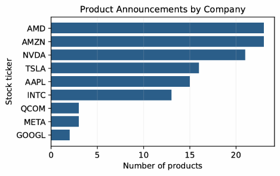
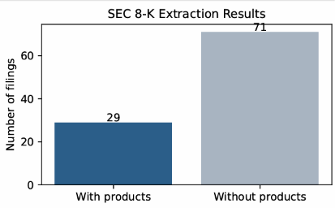

# SEC 8-K Product Announcement Extraction

This project was developed for my AI for FinTech course at the University of Central Florida. The goal is to extract new product announcements from SEC Form 8-K filings using a large language model (LLM).

## 1. Project Overview

SEC Form 8-K filings contain information about important corporate events. This project uses Python and an LLM to identify product announcements and organize the extracted information into a structured CSV file.

Each record contains:
- Company name
- Stock ticker
- Filing date
- New product name
- Product description (under 180 characters)

## 2. Tools and Libraries

- **Python:** Data collection and processing
- **BeautifulSoup:** HTML parsing
- **spaCy:** Named Entity Recognition (NER)
- **Gemini 3.1 Flash Lite:** Product extraction using an LLM
- **Pandas:** Data processing and CSV generation
- **Matplotlib:** Data visualization
- **Google Colab:** Notebook execution
- **Google Drive:** Saving results

## 3. Methodology

The extraction pipeline consists of five main steps:

1. Retrieve company CIK identifiers from SEC EDGAR.
2. Collect Form 8-K filings using the SEC Atom feed.
3. Extract text from the filings and relevant exhibits using BeautifulSoup.
4. Apply spaCy to identify organizations in the text.
5. Use Gemini 3.1 Flash Lite (`gemini-3.1-flash-lite`) to extract product announcements and generate structured JSON records.

The extracted data is converted into CSV format and saved to Google Drive.

## 4. Results

A total of 100 SEC Form 8-K filings were processed.

| Metric | Result |
|---|---:|
| Filings processed | 100 |
| Product records extracted | 119 |
| Companies with extracted products | 9 |
| Filings with product mentions (estimated) | 29 |
| Description length | Under 180 characters |

### Product Announcements by Company



### SEC 8-K Extraction Results



The figures summarize the distribution of extracted product mentions across companies and filings.

## 5. Output Format

The final CSV file contains the following columns:

```csv
company_name,stock_name,filing_time,new_product,product_description
```

The extracted data is stored in `sec_8k_products.csv`.

## 6. How to Run

1. Open `Townsend_assignment2.ipynb` in Google Colab.
2. Install the required Python libraries.
3. Mount Google Drive.
4. Configure the SEC request headers and Gemini API key.
5. Run the notebook cells in order.

The notebook saves the results and processing progress to Google Drive.

## 7. Limitations

- Not all 8-K filings contain new product announcements.
- Some extracted products may refer to existing products or commercial agreements.
- Long documents may contain relevant information beyond the text sent to the model.
- Gemini API rate limits may interrupt processing.

The extracted records have not all been manually verified against the original filings.

## 8. Data Source

U.S. Securities and Exchange Commission (SEC)

https://www.sec.gov/edgar/search/


M.S. in Computer Vision  
University of Central Florida
